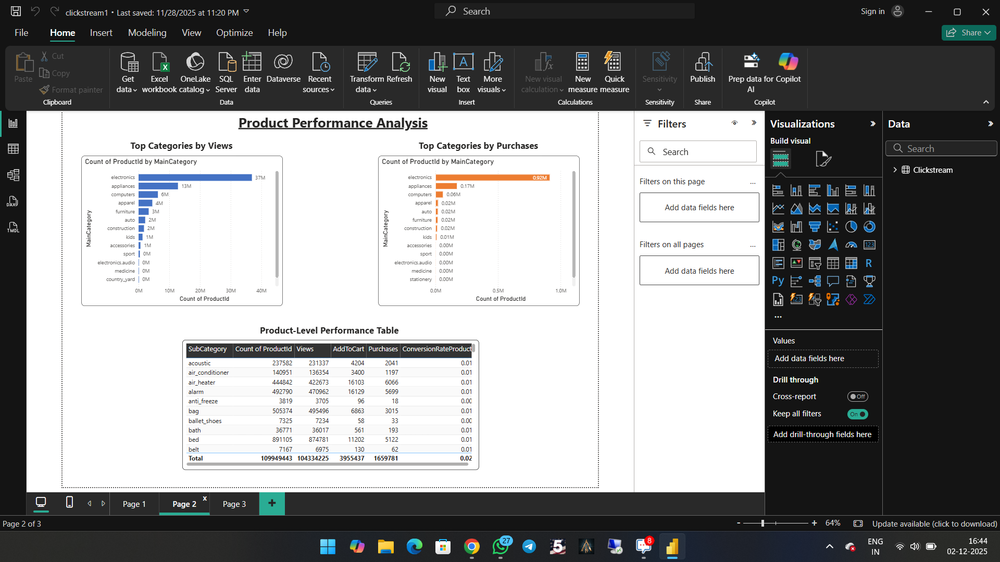
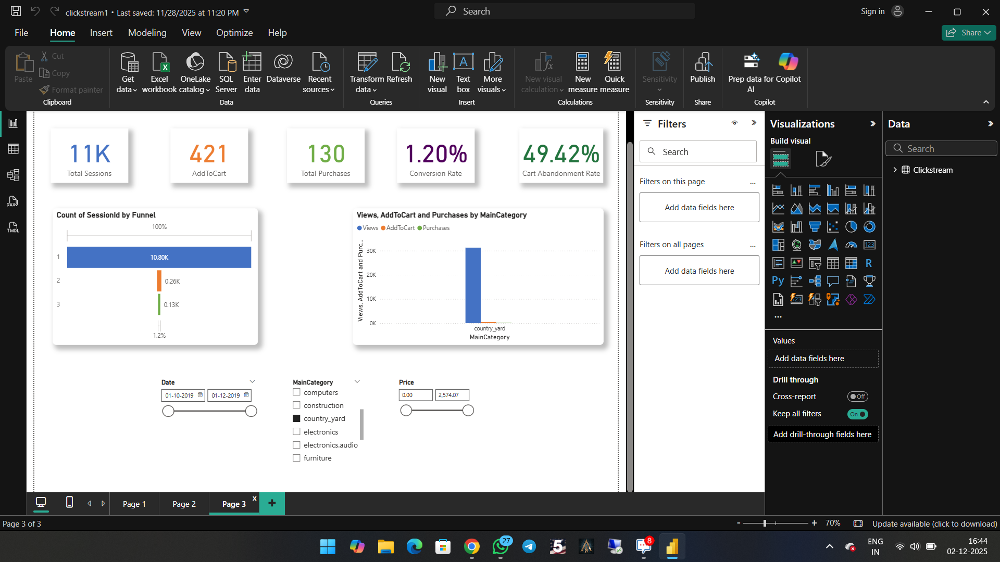

# 📊 E-Commerce Customer Behavior Analysis | Power BI

An interactive Power BI project focused on understanding e-commerce customer behavior, product performance, category-level trends, and purchase funnel drop-offs through data visualization.

## 📌 Project Overview

This project analyzes e-commerce customer behavior to explore purchasing patterns, evaluate product and category performance, and present business metrics through an interactive Power BI dashboard.

## 🎯 Business Objectives

- Understand customer behavior and engagement patterns.
- Analyze product and category performance.
- Examine the customer purchase funnel and identify potential drop-off points.
- Present business KPIs through interactive dashboards.
- Support data-driven decision-making through visual analysis.

## 🛠️ Tools & Technologies

- **Power BI:** Dashboard development and data visualization
- **DAX:** Measures and KPI calculations
- **Power Query:** Data preparation and transformation

## 📷 Dashboard Preview

### 1. Customer Behavior Overview

Explore the customer overview dashboard and its key performance indicators.

### 2. Product Performance

Explore product and category performance using the available dashboard visuals.

### 3. Funnel & Drop-Off Analysis

Examine the purchase funnel and customer drop-off patterns.

## 💡 Key Insights

The dashboard is designed to help investigate:

- Customer engagement and purchasing behavior.
- Product and category performance differences.
- Purchase funnel progression and potential drop-off points.
- Business KPIs that may highlight opportunities for improvement.

*Note: Add 3–5 specific findings supported by your dashboard data, including actual KPI values or percentages where available.*

## ⚙️ Methodology

1. Reviewed and prepared the dataset.
2. Transformed data using Power Query.
3. Developed the data model and required DAX measures.
4. Designed interactive dashboard pages and visualizations.
5. Examined KPIs and summarized business findings.

## 🚀 How to View the Project

**Dashboard preview:** Review the screenshots included above.

**Interactive report:**
1. Open this repository and locate the `.pbix` Power BI report file.
2. Download the file using GitHub's download option.
3. Open it in Microsoft Power BI Desktop to explore the report interactively.

## 👨‍💻 Author

**Devaraj S**  
Aspiring Data Analyst | Python | SQL | Power BI | Excel

- 💼 [Connect with me on LinkedIn](https://www.linkedin.com/in/devarajdataanalyst/)
- 💻 [Explore my GitHub profile](https://github.com/Deva0703)

---

*If you find this project interesting, feel free to explore the repository!*
