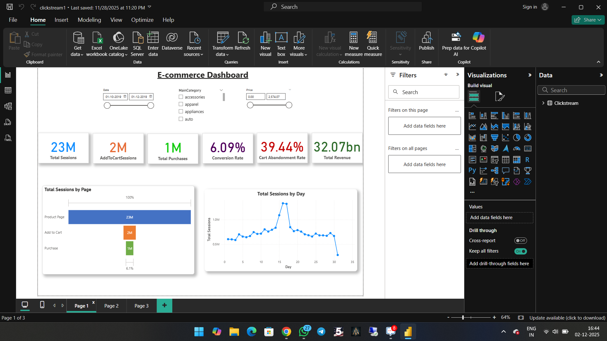

# E-Commerce Customer Behavior Analysis | Power BI

## Project Overview
This project explores e-commerce customer behavior using Power BI to identify patterns in customer activity, product performance, and purchasing behavior.

## Business Objectives
- Understand customer behavior and engagement.
- Analyse product and category performance.
- Examine the customer purchase funnel.
- Present key metrics through interactive dashboards.

## Tools Used
- Microsoft Power BI
- DAX
- Power Query

## Dashboard Preview
Add screenshots of your Customer Overview, Product Performance, and Funnel & Category Insights pages here.
### Customer Behavior Overview

### Product Performance

### Funnel & Drop-Off Analysis

## Key Insights
Document 3–5 verified insights from the dashboard. Include actual KPI values or percentages wherever available.

## Methodology
1. Reviewed and prepared the dataset.
2. Developed the required data model and measures.
3. Created interactive dashboard pages.
4. Analysed KPIs and summarized business insights.

## How to View
Review the screenshots above for a quick preview. To explore the interactive report, download the `.pbix` file and open it using Power BI Desktop.

## Author
Devaraj S  
Aspiring Data Analyst | Python | SQL | Power BI | Excel

LinkedIn: https://www.linkedin.com/in/devarajdataanalyst/
